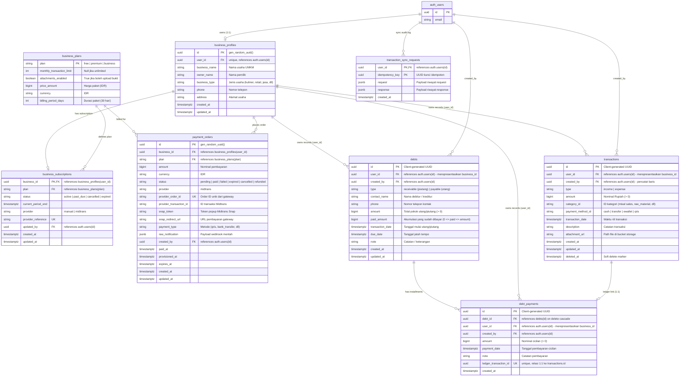

# Entity Relationship Diagram (ERD) - CatatUang

Dokumen ini mendokumentasikan skema aktif CatatUang yang didefinisikan dalam
`supabase/migrations/`. Akun yang sama menjadi Owner di aplikasi mobile dan
dashboard web; migrasi `20261107040000_owner_only_business_access.sql`
menghapus tabel keanggotaan dan batas jumlah anggota dari skema aktif.

---

## 1. Diagram Relasi Entitas (Mermaid ERD)

---

## 2. Penjelasan Rinci Entitas & Hubungan Antar Tabel

### A. Konvensi `business_id` vs `user_id` (Kritis)
Dalam skema asli database CatatUang:
- Setiap akun yang membuat usaha memiliki entri di `public.business_profiles`. Kolom `business_profiles.user_id` bernilai identik dengan `auth.users.id` pemilik (`owner`).
- Tabel turunan seperti `transactions`, `debts`, dan `debt_payments` menggunakan nama kolom **`user_id`** untuk merujuk pada **ID pemilik usaha** (yang berfungsi sebagai `business_id` bagi entitas usaha tersebut).
- Kolom **`created_by`** merekam akun Owner yang membuat catatan.

### B. Daftar Entitas

1. **`business_profiles`**
   - Menyimpan informasi identitas profil usaha UMKM (nama usaha, jenis usaha, kontak pemilik, alamat).
   - Relasi: 1-to-1 dengan `auth.users` melalui `user_id`.

2. **`business_plans` & `business_subscriptions`**
   - Mengatur tingkatan paket usaha (`free`, `premium`, `business`).
   - Menyimpan batas transaksi bulanan (`monthly_transaction_limit`) dan izin lampiran (`attachments_enabled`).

3. **`transactions`**
   - Mencatat arus kas keuangan (`income` atau `expense`).
   - Menggunakan soft delete (`deleted_at`).
   - Relasi dengan storage melalui `attachment_url` yang menunjuk ke bucket `transaction-attachments`.

4. **`debts` & `debt_payments`**
   - `debts` mencatat kewajiban utang (`payable`) atau hak tagih piutang (`receivable`).
   - Status pelunasan dilacak dari nilai `paid_amount` terhadap `amount`. Jika `paid_amount = amount`, maka utang telah lunas.
   - `debt_payments` mencatat riwayat cicilan. Setiap pencatatan cicilan wajib terhubung secara atomik (1:1) ke tabel `transactions` melalui `ledger_transaction_id` agar arus kas pembukuan tetap sinkron.

5. **`transaction_sync_requests`**
   - Tabel audit idempotency untuk mencegah duplikasi pencatatan transaksi saat klien mengirimkan sinkronisasi ulang.

6. **`payment_orders`**
   - Menyimpan rekaman transaksi pembayaran langganan melalui payment gateway Midtrans.

## 3. Penjelasan Kolom dan Tipe Data

Skema utama CatatUang menggunakan PostgreSQL melalui Supabase. Tipe seperti
`uuid`, `bigint`, `timestamptz`, dan `jsonb` di bawah ini mengikuti deklarasi
migrasi database, bukan tipe SQLite. Aplikasi mobile juga menyimpan sebagian
data secara lokal menggunakan Drift/SQLite; pada penyimpanan lokal, ID disimpan
sebagai teks, nominal sebagai integer, dan tanggal/waktu melalui kolom tanggal
Drift.

| Tipe Data | Penggunaan pada CatatUang | Alasan |
| :--- | :--- | :--- |
| `UUID` | ID akun dan usaha, transaksi, utang, pembayaran, serta relasi antartabel. | Menyediakan identifier unik yang dapat dibuat klien dan digunakan untuk sinkronisasi data. |
| `TEXT` | Nama dan kontak usaha, jenis/status transaksi, ID kategori dan metode pembayaran, catatan, URL lampiran, kode paket, serta referensi penyedia pembayaran. | Menyimpan string dan nilai kategori/status yang dibatasi oleh aturan aplikasi atau constraint database. |
| `BIGINT` | Nominal transaksi, utang, cicilan, harga paket, dan pembayaran dalam Rupiah. | Menyimpan nominal Rupiah sebagai bilangan bulat tanpa pembulatan pecahan desimal. |
| `INTEGER` | Batas transaksi bulanan dan durasi paket dalam hari. | Sesuai untuk nilai hitungan dan batas berukuran integer. |
| `BOOLEAN` | Flag paket seperti `attachments_enabled` serta flag modul seperti `is_default` dan `is_active`. | Menyatakan kondisi benar/salah secara langsung di PostgreSQL. |
| `TIMESTAMPTZ` | Waktu transaksi, jatuh tempo, pembayaran, masa langganan, serta waktu pembuatan, pembaruan, dan penghapusan. | Menyimpan waktu beserta konteks zona waktu untuk konsistensi lintas perangkat dan layanan. |
| `JSONB` | Permintaan/respons sinkronisasi, notifikasi mentah payment gateway, dan hasil terstruktur dari fungsi database. | Menyimpan payload terstruktur yang bentuk propertinya dapat bervariasi. |

`REAL` tidak digunakan untuk nominal keuangan pada skema aktif. Nilai Rupiah
disimpan sebagai `BIGINT`, sehingga nominal tidak mengalami galat representasi
bilangan pecahan.

`PRIMARY KEY` dan `UNIQUE` adalah constraint, bukan tipe data. Primary key
mengidentifikasi record, sedangkan constraint unik mencegah nilai duplikat pada
kolom yang ditentukan. Contoh constraint unik pada skema aktif meliputi
`business_profiles.user_id`, `payment_orders.provider_order_id`,
`business_subscriptions.provider_reference`, dan
`debt_payments.ledger_transaction_id`. Tabel
`transaction_sync_requests` menggunakan primary key gabungan
(`user_id`, `idempotency_key`).

SQLite tidak menyediakan tipe `UUID`, `BOOLEAN`, atau `TIMESTAMPTZ` dengan
semantik yang sama seperti PostgreSQL. Pada database lokal, Drift memetakan ID
ke `TEXT`, kolom jenis dan status seperti `type` dan `syncStatus` ke `TEXT`,
nominal dan penghitung percobaan sinkronisasi ke `INTEGER`, serta waktu ke
kolom tanggal Drift. Karena itu, deskripsi tipe data database lokal tidak boleh
disamakan dengan deklarasi tipe pada skema Supabase.
