# Entity Relationship Diagram (ERD) - CatatUang

Dokumen ini mendokumentasikan skema database asli CatatUang yang didefinisikan dalam `supabase/migrations/`.

---

## 1. Diagram Relasi Entitas (Mermaid ERD)

```mermaid
erDiagram
    auth_users ||--o| business_profiles : "owns (1:1)"
    auth_users ||--o{ business_members : "joins as member"
    business_profiles ||--o{ business_members : "has members"
    business_profiles ||--o| business_subscriptions : "has subscription"
    business_plans ||--o{ business_subscriptions : "defines plan"
    business_plans ||--o{ payment_orders : "billed for"
    business_profiles ||--o{ payment_orders : "places order"
    business_profiles ||--o{ transactions : "owns records (user_id)"
    auth_users ||--o{ transactions : "created_by"
    business_profiles ||--o{ debts : "owns records (user_id)"
    auth_users ||--o{ debts : "created_by"
    debts ||--o{ debt_payments : "has installments"
    business_profiles ||--o{ debt_payments : "owns records (user_id)"
    transactions ||--o| debt_payments : "ledger link (1:1)"
    auth_users ||--o{ transaction_sync_requests : "sync audit log"

    auth_users {
        uuid id PK
        string email
    }

    business_profiles {
        uuid id PK "gen_random_uuid()"
        uuid user_id FK "unique, references auth.users(id)"
        string business_name "Nama usaha UMKM"
        string owner_name "Nama pemilik"
        string business_type "Jenis usaha (kuliner, retail, jasa, dll)"
        string phone "Nomor telepon"
        string address "Alamat usaha"
        timestamptz created_at
        timestamptz updated_at
    }

    business_plans {
        string plan PK "free | premium | business"
        int max_members "Minimal 1"
        int monthly_transaction_limit "Null jika unlimited"
        boolean attachments_enabled "True jika boleh upload bukti"
        bigint price_amount "Harga paket (IDR)"
        string currency "IDR"
        int billing_period_days "Durasi paket (30 hari)"
    }

    business_subscriptions {
        uuid business_id PK,FK "references business_profiles(user_id)"
        string plan FK "references business_plans(plan)"
        string status "active | past_due | cancelled | expired"
        timestamptz current_period_end
        string provider "manual | midtrans"
        string provider_reference UK
        uuid updated_by FK "references auth.users(id)"
        timestamptz created_at
        timestamptz updated_at
    }

    business_members {
        uuid business_id PK,FK "references business_profiles(user_id)"
        uuid member_user_id PK,FK "unique, references auth.users(id)"
        string role "admin | cashier | viewer"
        uuid created_by FK "references auth.users(id)"
        timestamptz created_at
        timestamptz updated_at
    }

    transactions {
        uuid id PK "Client-generated UUID"
        uuid user_id FK "references auth.users(id) - merepresentasikan business_id"
        uuid created_by FK "references auth.users(id) - pencatat baris"
        string type "income | expense"
        bigint amount "Nominal Rupiah (> 0)"
        string category_id "ID kategori (misal sales, raw_material, dll)"
        string payment_method_id "cash | transfer | ewallet | qris"
        timestamptz transaction_date "Waktu riil transaksi"
        string description "Catatan transaksi"
        string attachment_url "Path file di bucket storage"
        timestamptz created_at
        timestamptz updated_at
        timestamptz deleted_at "Soft delete marker"
    }

    debts {
        uuid id PK "Client-generated UUID"
        uuid user_id FK "references auth.users(id) - merepresentasikan business_id"
        uuid created_by FK "references auth.users(id)"
        string type "receivable (piutang) | payable (utang)"
        string contact_name "Nama debitur / kreditur"
        string phone "Nomor telepon kontak"
        bigint amount "Total pokok utang/piutang (> 0)"
        bigint paid_amount "Akumulasi yang sudah dibayar (0 <= paid <= amount)"
        timestamptz transaction_date "Tanggal mulai utang/piutang"
        timestamptz due_date "Tanggal jatuh tempo"
        string note "Catatan / keterangan"
        timestamptz created_at
        timestamptz updated_at
    }

    debt_payments {
        uuid id PK "Client-generated UUID"
        uuid debt_id FK "references debts(id) on delete cascade"
        uuid user_id FK "references auth.users(id) - merepresentasikan business_id"
        uuid created_by FK "references auth.users(id)"
        bigint amount "Nominal cicilan (> 0)"
        timestamptz payment_date "Tanggal pembayaran cicilan"
        string note "Catatan pembayaran"
        uuid ledger_transaction_id UK "unique, relasi 1:1 ke transactions.id"
        timestamptz created_at
    }

    payment_orders {
        uuid id PK "gen_random_uuid()"
        uuid business_id FK "references business_profiles(user_id)"
        string plan FK "references business_plans(plan)"
        bigint amount "Nominal pembayaran"
        string currency "IDR"
        string status "pending | paid | failed | expired | cancelled | refunded"
        string provider "midtrans"
        string provider_order_id UK "Order ID unik dari gateway"
        string provider_transaction_id "ID transaksi Midtrans"
        string snap_token "Token popup Midtrans Snap"
        string snap_redirect_url "URL pembayaran gateway"
        string payment_type "Metode (qris, bank_transfer, dll)"
        jsonb raw_notification "Payload webhook mentah"
        uuid created_by FK "references auth.users(id)"
        timestamptz paid_at
        timestamptz provisioned_at
        timestamptz expires_at
        timestamptz created_at
        timestamptz updated_at
    }

    transaction_sync_requests {
        uuid user_id PK,FK "references auth.users(id)"
        uuid idempotency_key PK "UUID kunci idempoten"
        jsonb request "Payload riwayat request"
        jsonb response "Payload riwayat response"
        timestamptz created_at
    }
```

---

## 2. Penjelasan Rinci Entitas & Hubungan Antar Tabel

### A. Konvensi `business_id` vs `user_id` (Kritis)
Dalam skema asli database CatatUang:
- Setiap akun yang membuat usaha memiliki entri di `public.business_profiles`. Kolom `business_profiles.user_id` bernilai identik dengan `auth.users.id` pemilik (`owner`).
- Tabel turunan seperti `transactions`, `debts`, dan `debt_payments` menggunakan nama kolom **`user_id`** untuk merujuk pada **ID pemilik usaha** (yang berfungsi sebagai `business_id` bagi entitas usaha tersebut).
- Kolom **`created_by`** ditambahkan pada migrasi keamanan untuk merekam user spesifik (misal kasir atau admin) yang mengeksekusi operasi tersebut.

### B. Daftar Entitas

1. **`business_profiles`**
   - Menyimpan informasi identitas profil usaha UMKM (nama usaha, jenis usaha, kontak pemilik, alamat).
   - Relasi: 1-to-1 dengan `auth.users` melalui `user_id`.

2. **`business_members`**
   - Menghubungkan user lain (`member_user_id`) ke usaha tertentu (`business_id`).
   - Memiliki batasan role: `admin`, `cashier`, `viewer`.
   - Primary key komposit: `(business_id, member_user_id)`.
   - Constraint unik: `member_user_id` unik (satu user pada saat bersamaan hanya terdaftar di satu usaha sebagai anggota tim).

3. **`business_plans` & `business_subscriptions`**
   - Mengatur tingkatan paket usaha (`free`, `premium`, `business`).
   - Menyimpan batasan anggota (`max_members`), batas transaksi bulanan (`monthly_transaction_limit`), dan izin lampiran (`attachments_enabled`). Catatan: Pada migrasi terbaru (`20261102000000_free_transactions.sql`), batas transaksi bulanan diset `null` (bebas transaksi) dan upload bukti dibuka untuk seluruh paket.

4. **`transactions`**
   - Mencatat arus kas keuangan (`income` atau `expense`).
   - Menggunakan soft delete (`deleted_at`).
   - Relasi dengan storage melalui `attachment_url` yang menunjuk ke bucket `transaction-attachments`.

5. **`debts` & `debt_payments`**
   - `debts` mencatat kewajiban utang (`payable`) atau hak tagih piutang (`receivable`).
   - Status pelunasan dilacak dari nilai `paid_amount` terhadap `amount`. Jika `paid_amount = amount`, maka utang telah lunas.
   - `debt_payments` mencatat riwayat cicilan. Setiap pencatatan cicilan wajib terhubung secara atomik (1:1) ke tabel `transactions` melalui `ledger_transaction_id` agar arus kas pembukuan tetap sinkron.

6. **`transaction_sync_requests`**
   - Tabel audit idempotency untuk mencegah duplikasi pencatatan transaksi saat klien mengirimkan sinkronisasi ulang.

7. **`payment_orders`**
   - Menyimpan rekaman transaksi pembayaran langganan melalui payment gateway Midtrans.

